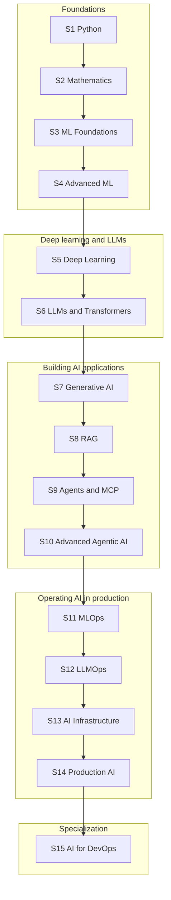

# ThinkWithOps — AI Engineering Learning Roadmaps

A structured, 15-season learning journey from Python and mathematics to production AI systems, LLMs, agents, MLOps, LLMOps, AI infrastructure and AI for DevOps — published alongside the **ThinkWithOps** YouTube channel.

## About ThinkWithOps

ThinkWithOps teaches AI and ML engineering concept-first and mechanism-focused: what a thing is, why it exists, how it works internally, how engineers use and troubleshoot it, and how it fails. DevOps, Linux, containers, Kubernetes and cloud topics appear where they support AI engineering.

📺 **YouTube channel:** *[ThinkWithOps channel link — coming soon]*

## Purpose of This Repository

This repository is the written companion to the video curriculum. It lets you see the whole path before you start, choose where to begin, and track what you have covered. Each season has an overview and a full roadmap listing every module, episode, topic and subtopic. As episodes are published, their practical code is added next to the roadmap: runnable teaching examples with a README that says how to run them. Practical materials published so far: Season 1, episode S01E01, including an optional practice exercise and solution. More are added as each episode is released.

## Curriculum at a Glance

| Seasons | Modules | Episodes | Topics (video chapters) | Subtopics |
|---:|---:|---:|---:|---:|
| 15 | 76 | 319 | 1,317 | 3,344 |

Hierarchy: **Season → Module → Episode → Topic → Subtopic**. A season is a course (one playlist), an episode is one video, topics are its chapters and subtopics are the detailed points inside each chapter.

## The Learning Journey



```text
Foundations        Deep learning & LLMs    Building AI apps            Operating AI                    Specialization
S1 → S2 → S3 → S4 → S5 → S6        → S7 → S8 → S9 → S10   → S11 → S12 → S13 → S14       → S15
```

## All Seasons

| # | Season | Modules | Episodes | Episode IDs | Level |
|---:|---|---:|---:|---|---|
| 1 | [Python for AI & ML Engineering](season-01-python-for-ai-ml/README.md) ([roadmap](season-01-python-for-ai-ml/roadmap.md)) | 3 | 18 | S01E01–S01E18 | Foundational → Intermediate |
| 2 | [Mathematics for AI & Machine Learning](season-02-mathematics-for-ai/README.md) ([roadmap](season-02-mathematics-for-ai/roadmap.md)) | 5 | 18 | S02E01–S02E18 | Foundational → Intermediate |
| 3 | [Machine Learning Foundations](season-03-machine-learning/README.md) ([roadmap](season-03-machine-learning/roadmap.md)) | 5 | 18 | S03E01–S03E18 | Foundational → Intermediate |
| 4 | [Advanced Machine Learning Engineering](season-04-advanced-ml-engineering/README.md) ([roadmap](season-04-advanced-ml-engineering/roadmap.md)) | 6 | 21 | S04E01–S04E21 | Intermediate → Advanced |
| 5 | [Deep Learning & Neural Networks](season-05-deep-learning/README.md) ([roadmap](season-05-deep-learning/roadmap.md)) | 9 | 28 | S05E01–S05E28 | Intermediate → Advanced |
| 6 | [LLMs & Transformer Architecture](season-06-llms-and-transformers/README.md) ([roadmap](season-06-llms-and-transformers/roadmap.md)) | 4 | 24 | S06E01–S06E24 | Intermediate → Advanced |
| 7 | [Generative AI Application Engineering](season-07-generative-ai-engineering/README.md) ([roadmap](season-07-generative-ai-engineering/roadmap.md)) | 5 | 21 | S07E01–S07E21 | Intermediate |
| 8 | [RAG Engineering](season-08-rag-engineering/README.md) ([roadmap](season-08-rag-engineering/roadmap.md)) | 4 | 19 | S08E01–S08E19 | Intermediate → Advanced |
| 9 | [AI Agents, Tool Calling & MCP](season-09-ai-agents-and-mcp/README.md) ([roadmap](season-09-ai-agents-and-mcp/roadmap.md)) | 4 | 18 | S09E01–S09E18 | Intermediate → Advanced |
| 10 | [Advanced Agentic AI](season-10-advanced-agentic-ai/README.md) ([roadmap](season-10-advanced-agentic-ai/roadmap.md)) | 4 | 15 | S10E01–S10E15 | Advanced |
| 11 | [MLOps Engineering](season-11-mlops-engineering/README.md) ([roadmap](season-11-mlops-engineering/roadmap.md)) | 5 | 27 | S11E01–S11E27 | Intermediate → Advanced |
| 12 | [LLMOps Engineering](season-12-llmops-engineering/README.md) ([roadmap](season-12-llmops-engineering/roadmap.md)) | 5 | 18 | S12E01–S12E18 | Advanced |
| 13 | [AI Infrastructure & Cloud Engineering](season-13-ai-infrastructure/README.md) ([roadmap](season-13-ai-infrastructure/roadmap.md)) | 5 | 22 | S13E01–S13E22 | Advanced |
| 14 | [Production AI Systems, Security & Governance](season-14-production-ai-systems/README.md) ([roadmap](season-14-production-ai-systems/roadmap.md)) | 4 | 20 | S14E01–S14E20 | Advanced |
| 15 | [AI for DevOps & Intelligent Operations](season-15-ai-for-devops/README.md) ([roadmap](season-15-ai-for-devops/roadmap.md)) | 8 | 32 | S15E01–S15E32 | Advanced specialization |
| | **Total** | **76** | **319** | | |

## How to Use This Repository

1. Read this page to see the full path and pick a starting point.
2. Open a season's `README.md` for a short overview, outcomes, prerequisites and module list.
3. Open its `roadmap.md` for the complete reference: every module, episode ID, objective, prerequisite, topic and subtopic.
4. Watch the matching episodes on the ThinkWithOps YouTube channel (playlist and roadmap-video links are marked *Coming soon* until published).
5. Open the episode's folder (for example `season-01-python-for-ai-ml/module-01-python-foundations-for-ml-engineers/01-how-python-executes-code/`) to read its README and run the code shown in the video.
6. Use the episode IDs (for example `S06E04`) to track progress and to follow prerequisites across seasons.

## Recommended Learning Order

Follow the seasons in numerical order if you want the full course. Each season assumes the ones before it unless its overview says otherwise.

| Stage | Seasons | Why this order |
|---|---|---|
| 1. Foundations | [1](season-01-python-for-ai-ml/README.md), [2](season-02-mathematics-for-ai/README.md), [3](season-03-machine-learning/README.md), [4](season-04-advanced-ml-engineering/README.md) | Python, mathematics and classical ML are the base every later season assumes |
| 2. Deep learning and LLMs | [5](season-05-deep-learning/README.md), [6](season-06-llms-and-transformers/README.md) | Neural networks lead into transformers and large language models |
| 3. Building AI applications | [7](season-07-generative-ai-engineering/README.md), [8](season-08-rag-engineering/README.md), [9](season-09-ai-agents-and-mcp/README.md), [10](season-10-advanced-agentic-ai/README.md) | Applications, retrieval, then agents and multi-agent systems |
| 4. Operating AI in production | [11](season-11-mlops-engineering/README.md), [12](season-12-llmops-engineering/README.md), [13](season-13-ai-infrastructure/README.md), [14](season-14-production-ai-systems/README.md) | Pipelines, LLM operations, infrastructure, then reliability, security and governance |
| 5. Specialization | [15](season-15-ai-for-devops/README.md) | Applies AI, LLMs and agents to DevOps and SRE work |

### Focused paths by career goal

Prefer a shorter route? These paths come from the curriculum design. “Core” seasons are required; “targeted” lists only the named episodes.

| Career path | Core | Targeted episodes |
|---|---|---|
| **Machine Learning Engineer** | S1, S2 (E01–E13, E17–E18), S3, S4, S5 (E01–E13, E25–E28), S11 | S5 E14–E24 by specialization (vision, audio, generative, RL); S6 (E01–E07, E14–E17); S13 (E01–E02, E05–E08); S14 (E01–E04) |
| **AI Engineer** | S1, S3 (E01–E05, E10–E15), S6, S7, S8, S9 | S2 (E01, E06–E07, E10–E13, E17); S5 (E01–E08); S12 (E04–E10); S14 (E01–E03, E05) |
| **Generative AI Engineer** | S1, S6, S7, S8, S9, S10 | S5 (E18–E21, E25); S12; S14 (E05–E06, E10) |
| **AI/ML Engineer (generalist)** | S1–S9, S11 | S10; S12; S13 (E01–E02, E12); S14 |
| **MLOps Engineer** | S1, S3 (E01–E03, E14–E18), S4 (E01–E04, E16, E21), S11, S13 | S2 (E13–E18); S5 (E07–E08, E26–E28); S12 (E01, E08–E10); S14 (E01–E04, E07–E09) |
| **DevOps/SRE Engineer → AI for Operations** | S15 (all); prior DevOps/SRE fundamentals (outside the curriculum) | S4 (E08, E09, E12); S8 (E01–E09, E13); S9 (E01–E06, E08–E11); S10 (E01–E04, E08); S12 (E04–E07); S14 (E02, E14, E17) |
| **LLMOps Engineer** | S1, S6, S7, S8, S9, S12, S13 | S10 (E08–E10, E12–E14); S11 (E01–E04, E20–E21, E23); S14 |

## Prerequisite Guidance

- **Starting out:** Season 1 has no prerequisites from other seasons. Basic comfort with a keyboard and a text editor is enough to begin.
- **Already know Python:** skim Season 1's [roadmap](season-01-python-for-ai-ml/roadmap.md) and start where the topics become new to you.
- **Season 15 (AI for DevOps):** assumes DevOps and SRE fundamentals, which are outside this curriculum, plus the AI building blocks from Seasons 4 and 6–10.
- **Episode-level prerequisites** are listed for every episode in each season's roadmap, and cross-season dependencies are summarized in each season README.

## Repository Layout

```text
thinkwithops-ai-learning-roadmaps/
├── README.md
├── season-01-python-for-ai-ml/
│   ├── README.md      # overview, outcomes, prerequisites, module list
│   ├── roadmap.md     # full module / episode / topic / subtopic reference
│   └── module-01-python-foundations-for-ml-engineers/
│       └── 01-how-python-executes-code/   # one folder per episode: README + runnable code
├── season-02-mathematics-for-ai/
│   └── ...
└── season-15-ai-for-devops/
    └── ...
```

## Video and Playlist Status

Season roadmap videos and YouTube playlists are not linked yet. Each season README has a clearly marked *Coming soon* placeholder that will be replaced when the content is published.
